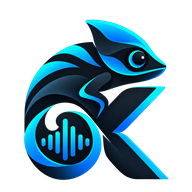
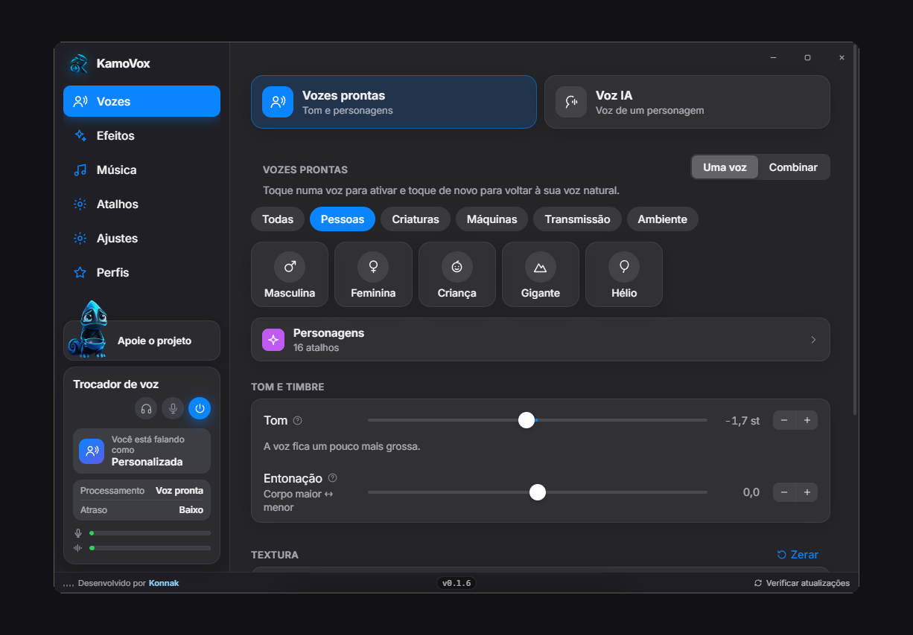
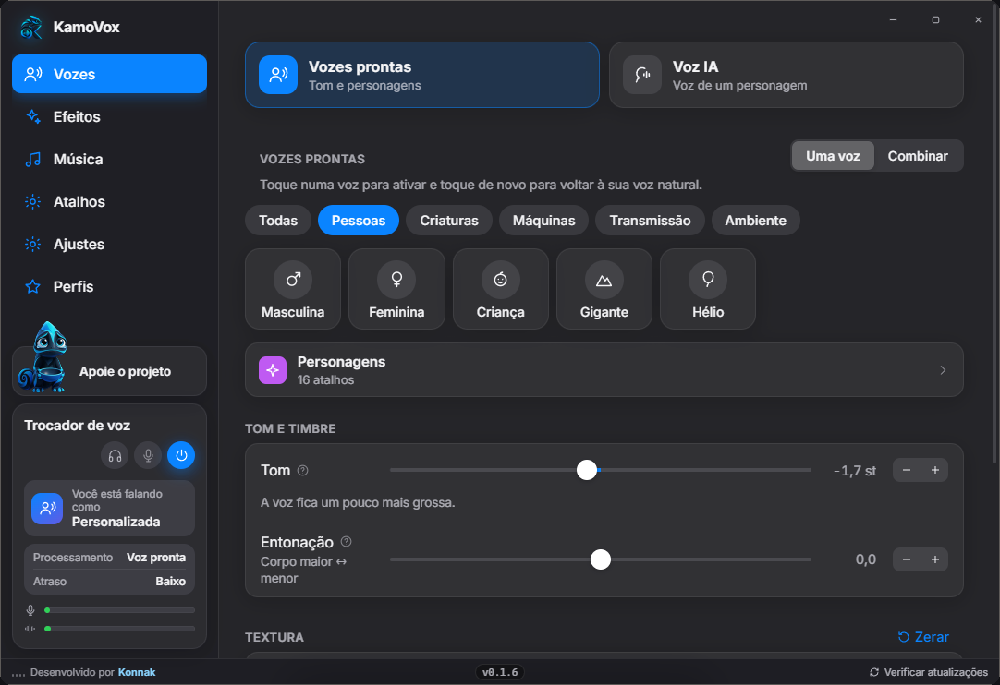
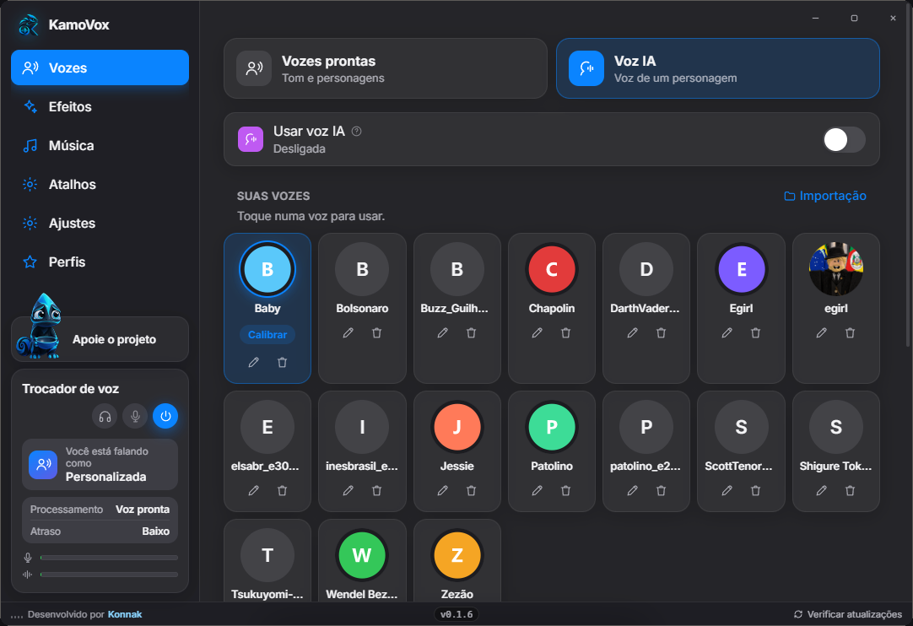
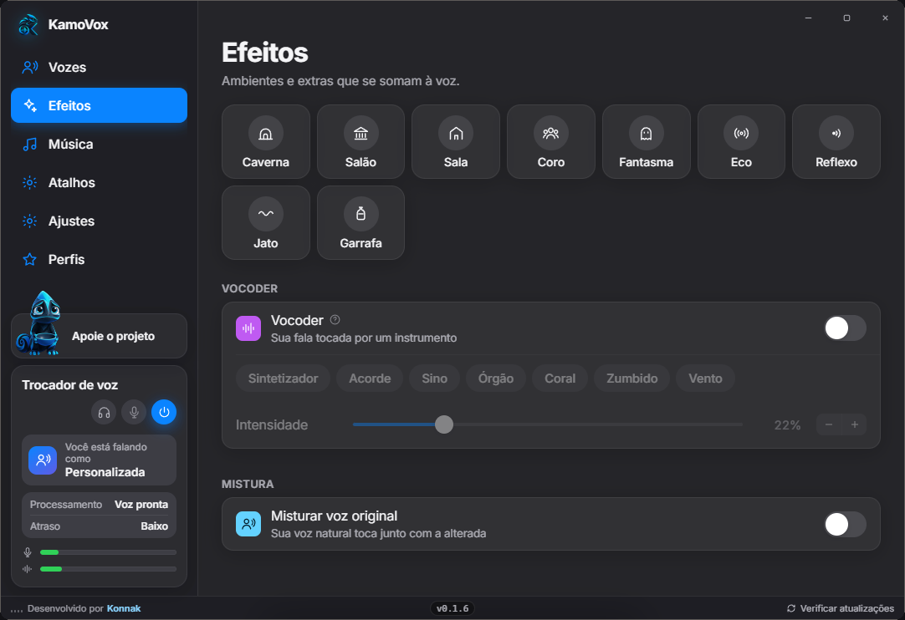
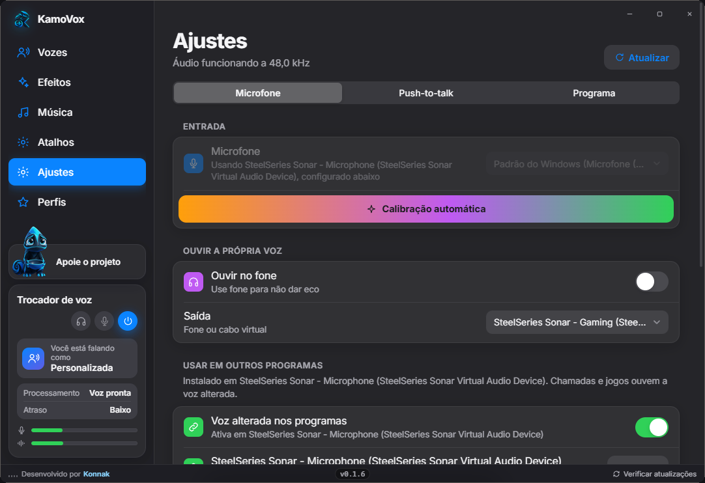
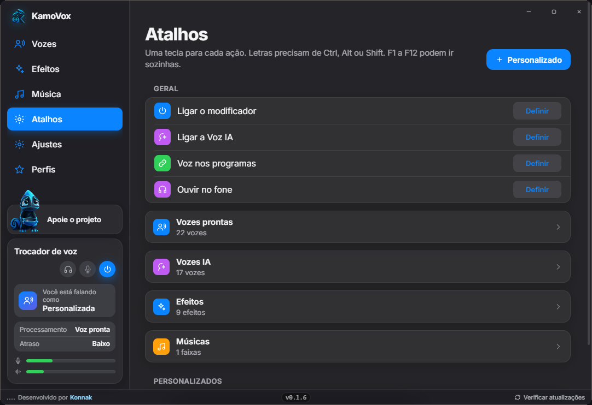

  

<h1 align="center">KamoVox</h1>

  Trocador de voz em tempo real para Windows, com o motor de áudio escrito em <b>Rust</b>. 
  Vozes prontas, voz de inteligência artificial, efeitos e microfone virtual para Discord, jogos e calls. 
  Grátis. Sem conta. Sem mensalidade. A sua voz não sai do seu PC.

  
  
  
  

  

  

  <a href="#funções">Funções</a> ·
  <a href="#desempenho">Desempenho</a> ·
  <a href="#baixar">Baixar</a> ·
  <a href="https://github.com/Konnak">Konnak</a>

<table>
  <tr>
    <td valign="top" width="25%">
      <h3>Tempo real</h3>
      Você fala, o outro lado já ouve a voz escolhida. Nas vozes prontas o atraso fica baixo — dá para conversar e jogar sem aquela defasagem de “rádio pirata”.
    </td>
    <td valign="top" width="25%">
      <h3>Motor em Rust</h3>
      O áudio não passa por nuvem nem por um script no navegador. Captura, DSP e saída rodam nativos no Windows, em Rust. A placa de vídeo entra só na voz IA, quando você liga.
    </td>
    <td valign="top" width="25%">
      <h3>Grátis de verdade</h3>
      Sem cadastro, sem plano, sem “3 vozes no gratuito”. O programa inteiro é seu. Se quiser ajudar, tem um Pix dentro do app. Não é obrigatório.
    </td>
    <td valign="top" width="25%">
      <h3>Discord e jogos</h3>
      O KamoVox instala um microfone no Windows. É esse microfone que o Discord e o jogo têm que ouvir. Sem isso, a call continua com a sua voz de verdade.
    </td>
  </tr>
</table>

## Funções

Os prints abaixo são a janela do programa, sem recorte de marketing.

<table>
  <tr>
    <td valign="top" width="50%">
      
      
<em>Vozes prontas, tom, entonação e personagens.</em>

      <h3>Vozes prontas</h3>
      Clique para ligar, clique de novo para voltar ao natural. Gente, criatura, máquina, rádio, ambiente. Se não quiser girar slider, <strong>Personagens</strong> já traz combinações prontas.
      
<strong>Tom</strong> muda a nota. <strong>Entonação</strong> muda o corpo da garganta, sem alterar o tom. <strong>Textura</strong> põe ar, rouquidão, vibrato. O modo Combinar mistura duas vozes ao mesmo tempo.

    </td>
    <td valign="top" width="50%">
      
      
<em>Voz IA: modelos no seu PC, com calibrar em cada carta.</em>

      <h3>Voz IA</h3>
      Aqui a conversão é outra: a sua fala vira a voz de um modelo. As vozes baixam <strong>dentro do programa</strong>. Não precisa caçar <code>.zip</code> nesta página.
      
Cada carta tem <strong>Calibrar</strong>: o KamoVox ouve o microfone que já está ligado e acerta o deslocamento de tom. Dá para importar um modelo RVC (<code>.pth</code>) se você tiver o seu.

    </td>
  </tr>
  <tr>
    <td valign="top" width="50%">
      
      
<em>Caverna, eco, vocoder — por cima da voz, não no lugar dela.</em>

      <h3>Efeitos</h3>
      Caverna, salão, eco, coro, vocoder. O vocoder usa o ritmo da sua fala para “tocar” um instrumento. Se quiser, mistura a voz original junto.
    </td>
    <td valign="top" width="50%">
      
      
<em>Microfone, calibração e a voz alterada nos outros programas.</em>

      <h3>No Discord e nos jogos</h3>
      Calibração automática no próprio microfone do programa. Ouvir no fone antes de soltar na call. Push-to-talk. Abrir junto com o Windows. O cartão da barra esquerda mostra se está saindo voz e quanto de atraso tem.
    </td>
  </tr>
</table>

  

<em>Uma tecla para ligar o modificador, trocar de voz ou mandar música no microfone.</em>

Letra precisa de Ctrl, Alt ou Shift. F1 a F12 podem ir sozinhas. Em **Música**, o áudio vai para o microfone — não só para o seu fone. **Perfis** guardam a combinação inteira para voltar nela depois.

## Desempenho

O KamoVox não manda a sua voz para um servidor. O caminho é local: microfone → motor em Rust → microfone virtual do Windows.

- **Vozes prontas.** DSP nativo (`kamovox-dsp`), captura com cpal. O cartão da barra mostra **Atraso: Baixo**. Dá para usar em call e em jogo.
- **A 48 kHz** quando o dispositivo aguenta. O cabeçalho de Ajustes mostra a taxa em que o áudio está rodando.
- **Voz IA.** Roda no seu PC. Se tiver placa de vídeo, usa ela; se não tiver, usa o processador e o programa mostra o atraso. Presets de desempenho, equilibrado e qualidade — você escolhe entre naturalidade e latência.
- **Rust, não um site embrulhado.** A interface é um app Windows (Tauri). O que importa para o som — captura, troca de voz, efeitos, saída — está em Rust. Não tem conta na nuvem para “ativar” a voz.

O botão azul da barra esquerda liga o trocador. Fecha a janela e o camaleão continua na bandeja, ao lado do relógio. Para sair de verdade, use o menu de lá.

## Baixar

O arquivo certo é só este:

**[KamoVox_0.1.6_x64-setup.exe](https://github.com/Konnak/KamoVox/releases/latest/download/KamoVox_0.1.6_x64-setup.exe)** — cerca de 160 MB, Windows 10 e 11, 64 bits.

Alguns pacotes de voz já vêm no instalador. O resto o programa baixa quando você escolhe a voz.

Os `.zip` que aparecem no GitHub **não são o programa**. São os pacotes. Ficam numa [release separada](https://github.com/Konnak/KamoVox/releases/tag/voices), de propósito. Não baixe eles na mão.

O instalador ainda não tem assinatura digital. O Windows mostra “O Windows protegeu o seu PC”. Clique em **Mais informações**, depois **Executar assim mesmo**. Na primeira abertura pede administrador **uma vez**: é para instalar o microfone virtual.

1. Instale o `.exe`.
2. Abra o KamoVox, escolha o microfone, ligue **Voz alterada nos programas**.
3. No Discord ou no jogo, selecione o microfone do KamoVox.
4. Ligue o botão de energia na barra esquerda e escolha uma voz.

Internet só entra na história para atualizar e para baixar voz nova. No rodapé, **Verificar atualizações** pergunta antes de instalar.

---

KamoVox é um projeto pessoal do [Konnak](https://github.com/Konnak). O camaleão da barra não cobra café. Se alguém quiser, o botão **Apoie o projeto** está dentro do programa.
